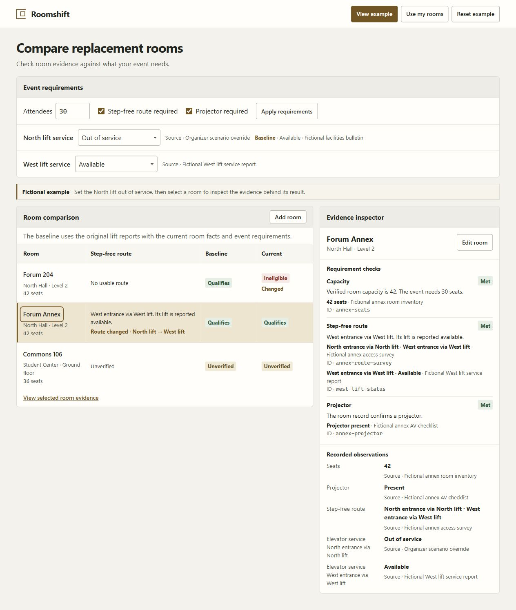

# Roomshift

Roomshift helps student organizers keep campus events accessible after a last-minute venue change. It compares replacement rooms against event requirements and shows the route surveys and lift reports behind each result. When evidence is missing, it tells the organizer what to verify before announcing the move.

**EvoHacks 2 · Projects for Social Good.** A room change can leave attendees who need step-free access without a usable way into the event. Roomshift helps organizers check whether the replacement room still has a documented step-free route before they send the new location.

**Demo.** [Open Roomshift](https://rhythm-sanghi.github.io/Roomshift/). The [local setup](#run-from-a-clean-checkout) is available as a fallback. The campus, rooms, surveys, and lift reports are fictional. Each result is an evaluation of the supplied evidence.



## Try the demo

| Time | Try this |
| --- | --- |
| 0:00–0:10 | Open the fictional example for a 30-person event requiring a step-free route and a projector. |
| 0:10–0:26 | Set **North lift service** to **Out of service**. Forum 204 becomes **Ineligible** and cites the scenario override. Forum Annex still **Qualifies**, and Commons 106 stays **Unverified**. |
| 0:26–0:44 | Find the Annex’s **Route changed** note, then select **Forum Annex**. The step-free check names the West lift and cites the access survey and the West lift service report. |
| 0:44–1:00 | Set **West lift service** to **Unverified — no report**. The Annex becomes **Unverified**, and the inspector identifies the service report to obtain. |

Set the West lift to **Available**, set **Attendees** to **45**, and select **Apply requirements**. The Annex becomes ineligible because it has 42 seats. Its West lift route still meets the access requirement. Lift edits are labeled as organizer scenario overrides. The baseline uses the original reports with the current room facts and event requirements. **Reset example** restores the fictional rooms, requirements, and original reports after confirmation.

To try your own inputs, select **Use my rooms**. For the default 30-person event with the projector requirement off, add a room with a verified direct route and 18 seats. It is **Ineligible** and the inspector cites the 18-seat observation. Edit the room to 30 seats and it **Qualifies**. Saved rooms and unfinished edits stay in their workspace when you switch and clear on reload.

## Run from a clean checkout

Use Node 20.19+ on the 20.x line or Node 22.12+.

```sh
npm ci
npm run dev
```

Open the URL printed in the terminal. Run `npm test` to check the evaluator.

## How Roomshift evaluates a room

The [evaluator](src/evaluation/evaluateRoom.ts) takes [room observations](src/roomFacts.ts), event requirements, and current lift reports. It checks capacity for every room and checks step-free access and the projector when required. The [contract](src/evaluation/contract.ts) returns a status, an explanation, and supporting observation IDs for each active requirement. The [inspector](src/EvidenceInspector.tsx) uses those IDs to show the sources.

- One usable surveyed route satisfies step-free access. A direct route needs no lift report. A lift route needs a report that says the lift is available.
- If no route is usable and a lift report is missing, the route check stays **Unverified**. A missing survey is also **Unverified**. A survey confirming no route, or reports confirming all surveyed routes are closed, makes the check **Unmet**.
- Any unmet requirement makes the room **Ineligible**. With no failures, missing evidence for a required check makes it **Unverified**. A room **Qualifies** only when every active requirement is met. The inspector shows every active check.
- The [fictional campus](src/example.ts) and custom rooms use the same evaluator. Observations are entered manually and reset on reload. Confirm current capacity, equipment, and route conditions with the venue or campus facilities before moving an event.

The [test cases](tests/evaluationCases.ts) cover exact capacity, optional requirements, both lifts closed, missing service, missing and empty surveys, and deduplicated citations.

## Contributions

**Rhythm Sanghi led the product and design.** He defined the student organizer’s workflow, the rules for qualifying a room and handling missing evidence, the fictional lift-outage scenario, and the visual direction for the comparison and evidence inspector.

**AI-assisted development.** Codex implemented the evaluator and browser app, created the sample data and tests, and assisted with verification and submission drafts.

- **Dependencies** include React and React DOM for the UI, Vite for bundling and preview, TypeScript and React type definitions for type checking, and Node’s built-in test runner. The demo uses fictional observations created for Roomshift.
- **Pre-existing references** include [Threadmark](https://github.com/Rhythm-Sanghi/Threadmark) and [Benchlight](https://github.com/Rhythm-Sanghi/Benchlight). Their interaction and visual patterns informed the design. Roomshift uses its own code and assets. There are no external datasets or sponsor integrations.
